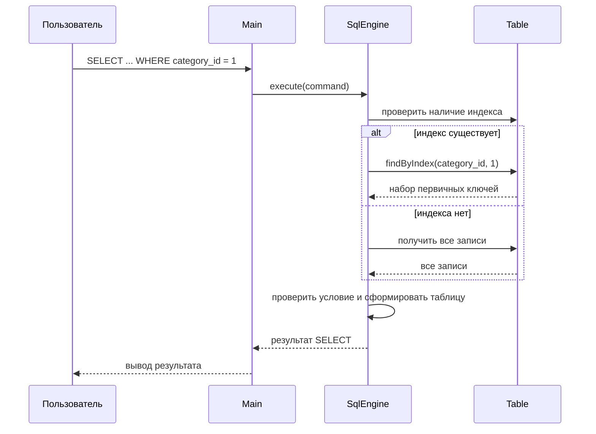

# PC Store MiniDB — упрощённая СУБД на Java.

## 1. Предметная область и структура таблиц

`categories` — категории компьютерных комплектующих.

| Поле | Тип | Назначение |
|---|---|---|
| id | INT | первичный ключ |
| name | STRING | название категории |
| description | STRING | описание |

`components` — товары каталога.

| Поле | Тип | Назначение |
|---|---|---|
| id | INT | первичный ключ |
| name | STRING | название комплектующего |
| category_id | INT | внешний ключ на categories.id |
| price | DOUBLE | цена |
| release_date | DATE | дата выпуска |
| in_stock | BOOLEAN | наличие на складе |

Связь: одна категория может содержать много комплектующих (1:N).

### Последовательность SELECT с индексом



## 4. Запуск

Требуется JDK 8 или новее и Maven.

Из корневой папки проекта:

```bash
mvn clean package
java -jar target/pc-store-db-1.0.jar
```

Либо запустите класс `pcdb.Main` из IntelliJ IDEA. Рабочая папка должна быть корнем проекта, чтобы файл `data/pcstore.db` создавался в папке `data`.

## 5. Пример работы

Вводите команды по одной строке. В конце каждой команды можно ставить `;`.

```sql
CREATE TABLE categories (id INT PRIMARY KEY, name STRING, description STRING);
CREATE TABLE components (id INT PRIMARY KEY, name STRING, category_id INT, price DOUBLE, release_date DATE, in_stock BOOLEAN, FOREIGN KEY (category_id) REFERENCES categories(id));

INSERT INTO categories VALUES (1, 'Процессоры', 'CPU');
INSERT INTO categories VALUES (2, 'Видеокарты', 'GPU');

INSERT INTO components VALUES (1, 'AMD Ryzen 7', 1, 28999.0, '2025-01-15', TRUE);
INSERT INTO components VALUES (2, 'Intel Core i5', 1, 19999.0, '2024-06-10', TRUE);
INSERT INTO components (id, name, category_id) VALUES (3, 'GeForce RTX', 2);

SELECT * FROM components;
SELECT name, price FROM components WHERE price > 20000.0;

CREATE INDEX idx_components_category ON components (category_id);
SELECT * FROM components WHERE category_id = 1;

UPDATE components SET price = 30000.0 WHERE id = 1;
DELETE FROM components WHERE id = 2;
```

Для проверки восстановления завершите программу командой `EXIT` и запустите её повторно. Ранее созданные таблицы, записи и индексы должны сохраниться.

```bash
mvn test-compile
java -cp target/test-classes:target/classes pcdb.PerformanceTest

