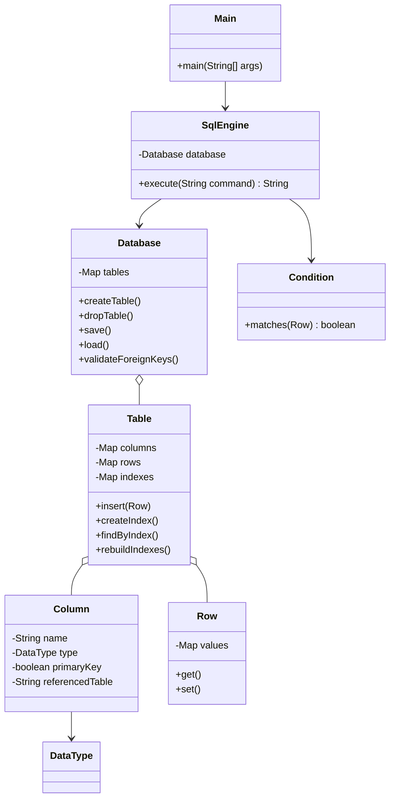
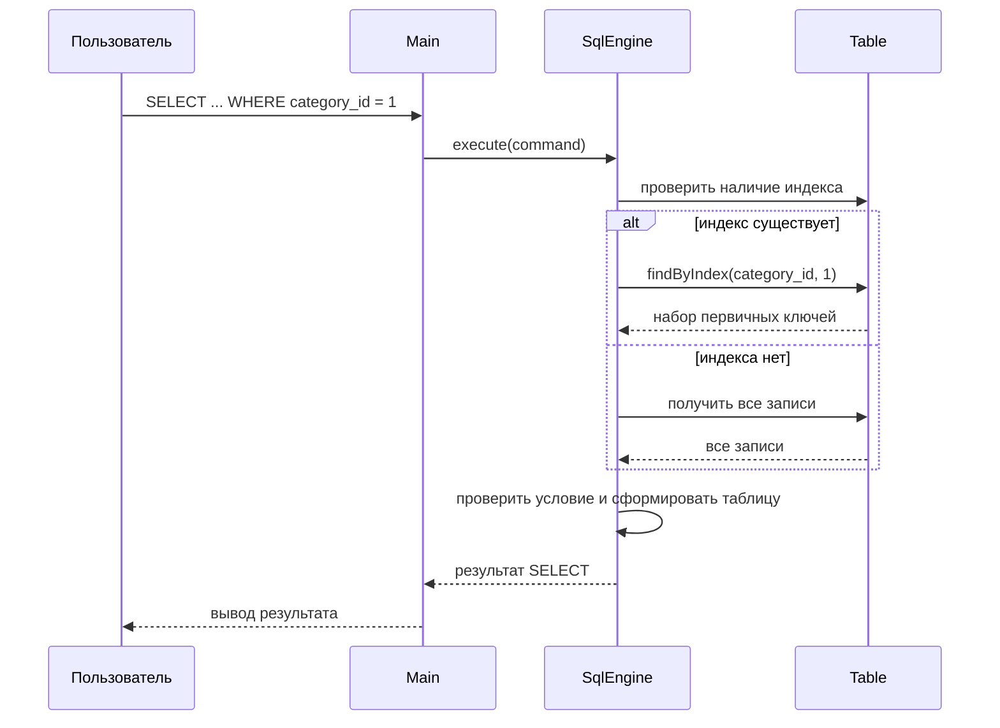
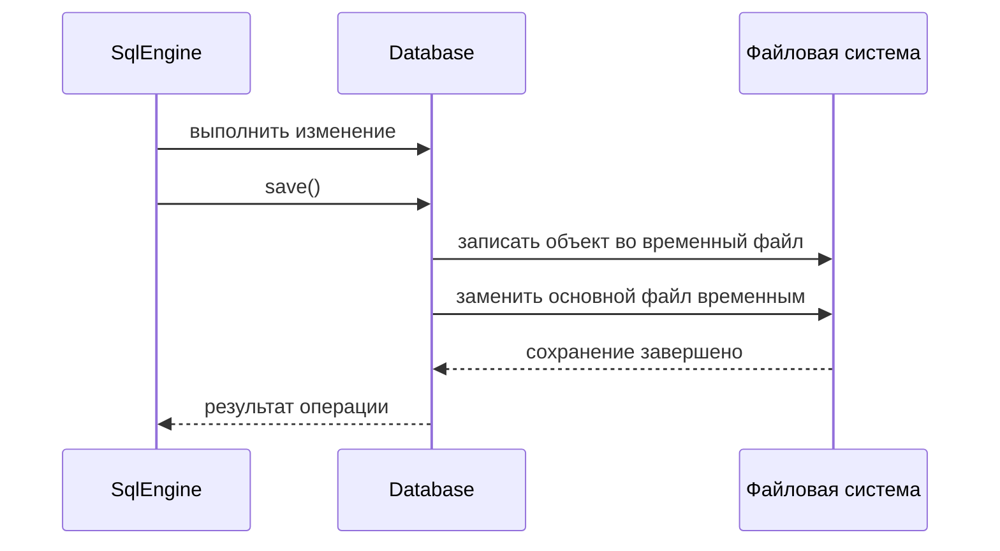

# PC Store MiniDB — упрощённая СУБД на Java

Учебная реализация файловой мини-СУБД для предметной области магазина компьютерных комплектующих. Проект использует Java 8+, Maven и консольный интерфейс.

## 1. Реализованные требования

- Две связанные таблицы: `categories` и `components`.
- Поддерживаемые типы: `INT`, `DOUBLE`, `STRING`, `DATE`, `BOOLEAN`.
- Хранение структуры, записей и определений индексов в бинарном файле с помощью Java Serialization.
- Загрузка базы при запуске.
- `INSERT INTO` (одна или несколько записей в одной команде; можно указывать список столбцов).
- `SELECT` с `*` или перечислением столбцов и одним условием `WHERE`.
- `UPDATE` и `DELETE` с условием `WHERE`.
- Проверка уникальности первичного ключа.
- Проверка внешнего ключа при добавлении и изменении записи.
- `CREATE TABLE` и `DROP TABLE`.
- `CREATE INDEX`; индексные определения сохраняются в файле базы и восстанавливаются при запуске.
- `SELECT` с условием равенства по индексированному столбцу использует индекс.
- Вывод результата SELECT в табличном виде.
- Сохранение после каждой операции изменения. Для сохранения сначала создаётся временный файл, затем он заменяет основной.
- Javadoc для основных классов и публичных методов.

### Ограничения реализованного SQL-подмножества

Это учебная мини-СУБД, а не полноценный сервер SQL. Поддерживается один запрос на строку, одно простое условие `WHERE` (без `AND`/`OR`), без `JOIN`, сортировки и транзакций. `UPDATE` требует `WHERE`, чтобы случайно не изменить всю таблицу. `DELETE` без `WHERE` удаляет все строки таблицы, если на них нет ссылок из другой таблицы. Внешние ключи ссылаются на первичный ключ типа `INT`.

## 2. Предметная область и структура таблиц

`categories` — категории компьютерных комплектующих.

| Поле | Тип | Назначение |
|---|---|---|
| id | INT | первичный ключ |
| name | STRING | название категории |
| description | STRING | описание |

`components` — товары каталога.

| Поле | Тип | Назначение |
|---|---|---|
| id | INT | первичный ключ |
| name | STRING | название комплектующего |
| category_id | INT | внешний ключ на categories.id |
| price | DOUBLE | цена |
| release_date | DATE | дата выпуска |
| in_stock | BOOLEAN | наличие на складе |

Связь: одна категория может содержать много комплектующих (1:N).

## 3. Архитектура



### Последовательность SELECT с индексом



### Последовательность сохранения



## 4. Запуск

Требуется JDK 8 или новее и Maven.

Из корневой папки проекта:

```bash
mvn clean package
java -jar target/pc-store-db-1.0.jar
```

Либо запустите класс `pcdb.Main` из IntelliJ IDEA. Рабочая папка должна быть корнем проекта, чтобы файл `data/pcstore.db` создавался в папке `data`.

## 5. Пример работы

Вводите команды по одной строке. В конце каждой команды можно ставить `;`.

```sql
CREATE TABLE categories (id INT PRIMARY KEY, name STRING, description STRING);
CREATE TABLE components (id INT PRIMARY KEY, name STRING, category_id INT, price DOUBLE, release_date DATE, in_stock BOOLEAN, FOREIGN KEY (category_id) REFERENCES categories(id));

INSERT INTO categories VALUES (1, 'Процессоры', 'CPU');
INSERT INTO categories VALUES (2, 'Видеокарты', 'GPU');

INSERT INTO components VALUES (1, 'AMD Ryzen 7', 1, 28999.0, '2025-01-15', TRUE);
INSERT INTO components VALUES (2, 'Intel Core i5', 1, 19999.0, '2024-06-10', TRUE);
INSERT INTO components (id, name, category_id) VALUES (3, 'GeForce RTX', 2);

SELECT * FROM components;
SELECT name, price FROM components WHERE price > 20000.0;

CREATE INDEX idx_components_category ON components (category_id);
SELECT * FROM components WHERE category_id = 1;

UPDATE components SET price = 30000.0 WHERE id = 1;
DELETE FROM components WHERE id = 2;
```

Для проверки восстановления завершите программу командой `EXIT` и запустите её повторно. Ранее созданные таблицы, записи и индексы должны сохраниться.

## 6. Тестирование

Проверяются следующие случаи:

1. Создание обеих таблиц и внешнего ключа.
2. Вставка корректной записи.
3. Отклонение повторного первичного ключа.
4. Отклонение внешнего ключа, которого нет в родительской таблице.
5. Выборка всех полей и отдельных столбцов.
6. Фильтрация сравнением чисел, строк, дат и логических значений.
7. Изменение и удаление записей.
8. Создание индекса и выполнение равенства по индексированному столбцу.
9. Перезапуск приложения и восстановление записей и индексов.
10. Запрет удаления категории, если на неё ссылаются комплектующие.

### Сравнение производительности

В проект включён `PerformanceTest`. Он создаёт 100 000 записей и сравнивает поиск 1 значения линейным перебором и через индекс. Чтобы запустить:

```bash
mvn test-compile
java -cp target/test-classes:target/classes pcdb.PerformanceTest
```

Тест выводит фактическое время на конкретном компьютере и проверяет, что оба способа находят одинаковое количество записей. Время зависит от процессора, JVM, фоновой нагрузки и прогрева JVM, поэтому в отчёт следует перенести числа, полученные при запуске на компьютере, где выполняется защита. Индекс сокращает область поиска до набора ключей для конкретного значения; линейный поиск проверяет все 100 000 записей.

## 7. Обработка ошибок и надёжность

- Некорректные команды и значения типов обрабатываются исключениями; программа выводит сообщение и продолжает работу.
- Первичный ключ обязателен и уникален.
- Внешний ключ проверяется перед сохранением строки.
- Нельзя удалить таблицу, на которую ссылается другая таблица.
- Нельзя удалить родительскую запись, пока на неё ссылаются дочерние записи.
- После каждой операции изменения база сохраняется через временный файл с последующим переименованием.
- Если файл базы не удаётся прочитать, он перемещается в файл с расширением `.corrupt`, а программа запускается с пустой базой. Это аварийное восстановление сохраняет повреждённый файл для последующего анализа, но не гарантирует восстановление его содержимого.

## 8. Использованные технологии и источники

- Java SE 8 Documentation: https://docs.oracle.com/javase/8/docs/
- Java Object Serialization Specification: https://docs.oracle.com/javase/8/docs/platform/serialization/spec/serialTOC.html
- Java NIO Files: https://docs.oracle.com/javase/8/docs/api/java/nio/file/Files.html
- Maven: https://maven.apache.org/

## 9. Область ответственности участников

Работа выполнена индивидуально: проектирование структуры таблиц, реализация хранения и индексов, парсер SQL-команд, консольный интерфейс, тестирование и документация.
