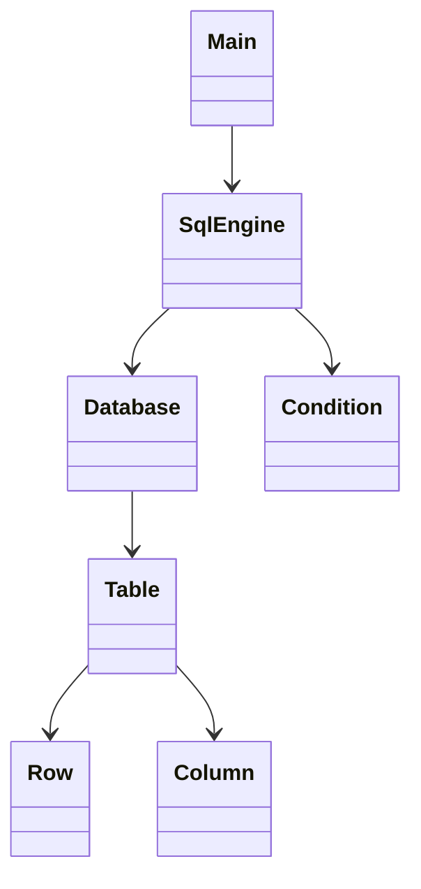
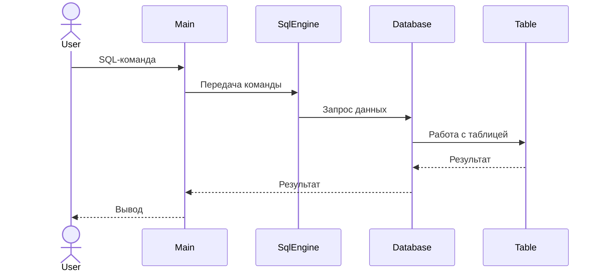

## Гарафутдинов Лев Давидович 25КНТ-6
## 1. Архитектура системы

Основные классы программы:

- `Main` — взаимодействие с пользователем.
- `SqlEngine` — обработка SQL-команд.
- `Database` — управление базой данных и сохранение файлов.
- `Table` — работа с записями и индексами.
- `Row` — хранение записей.
- `Column` — описание столбцов.
- `Condition` — проверка условий поиска.
- `DataType` — типы данных.

Диаграмма классов:



Диаграмма последовательности:



## 2. Результаты тестирования производительности

Тест проводился на 100 000 записях.

| Способ поиска | Время |
|---|---:|
| Без индекса | 4,24 мс |
| С индексом | 0,40 мс |

Использование индекса ускорило поиск примерно в 10,6 раза.

## 3. Инструкция пользователя

Для запуска необходимо открыть проект в IntelliJ IDEA и запустить `Main.java`.

Примеры команд:

```sql
CREATE TABLE categories (id INT PRIMARY KEY, name STRING, description STRING);

INSERT INTO categories VALUES (1, 'Процессоры', 'CPU');

SELECT * FROM categories;

SELECT * FROM categories WHERE id = 1;
```

## 4. Область ответственности участников

Работа выполнена индивидуально.

## 5. Выводы

В ходе лабораторной работы была разработана мини-СУБД PCStoreDB на Java. Реализованы создание таблиц, добавление, поиск, изменение и удаление записей, проверка ключей, сохранение данных и индексация. Тестирование показало, что использование индекса ускоряет поиск.

## 6. Использованные источники
https://www.youtube.com/watch?v=0beocykXUag
https://www.youtube.com/watch?v=k0boqNw13Mc
А так же лекции Максима Л.))
